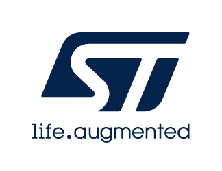

# Release Notes for
# <mark>STM32F412G_Discovery Board Drivers</mark>
Copyright &copy; 2017 STMicroelectronics\
    

# Purpose

This directory contains the board drivers to demonstrate the capabilities of the STM32F412G_Discovery Board Drivers.

# Update History

<label for="collapse-section7" aria-hidden="true">V2.1.1 / 16-October-2026</label>

## Main Changes

- Fix demo not working on STM32F412G-Disco (MB1209-D02)

<label for="collapse-section6" aria-hidden="true">V2.1.0 / 14-May-2024</label>

## Main Changes

- Update to manage touch screen components (ft6x06 & ft3x67) available on different STM32412G-Discovery board revisions in dynamic approach

<label for="collapse-section5" aria-hidden="true">V2.0.3 / 09-October-2023</label>

			

## Main Changes

- Update Release_Notes.html to support new format
- Removal of invalid COM2 argument for the BSP_COM_Init() function

<label for="collapse-section4" aria-hidden="true">V2.0.2 / 11-Fabruary-2022</label>

			

## Main Changes

- All source files: update disclaimer to add reference to the new license agreement
- Update to support the ft3x67 component
- Fix wrong tearing effect pin (LCD_TE_PIN)

<label for="collapse-section3" aria-hidden="true">V2.0.1 / 25-September-2017</label>

## Main Changes

- Add general description of BSP drivers
- Remove date & version
- stm32412g_discovery_lcd.c:
  - Update  BSP_LCD_DrawBitmap() API to fix functional misbehaviour with SW4STM32 Toolchain

<label for="collapse-section2" aria-hidden="true">V2.0.0 / 27-January-2017</label>

## Main Changes

- stm32412g_discovery_sd.c/.h:
  - Update BSP SD APIs following new HAL SD drivers implementation
  - Fix BlockSize to 512 bytes
- stm32412g_discovery_audio.c/.h:
  - Support multi-buffering
  - Add BSP_AUDIO_IN_ConfigMicDefault and BSP_AUDIO_IN_ConfigDigitalMic APIs
- stm32412g_discovery_ts.c/.h:
  - Add support of 180° orientation
- stm32412g_discovery_lcd.c/.h:
  - Add support of 180° orientation

## Notes:
  - These BSP drivers break the compatibility with previous versions.
  - If FatFs is required, "FatFS R0.11 ST modified 20161223" must be used with this version of BSP drivers.

<label for="collapse-section1" aria-hidden="true">V1.0.0 / 04-May-2016</label>

## Main Changes

- First official version of the STM32F412G Discovery Board Drivers

For complete documentation on <mark>STM32 Microcontrollers</mark> ,
visit: [http://www.st.com/STM32](http://www.st.com/STM32)